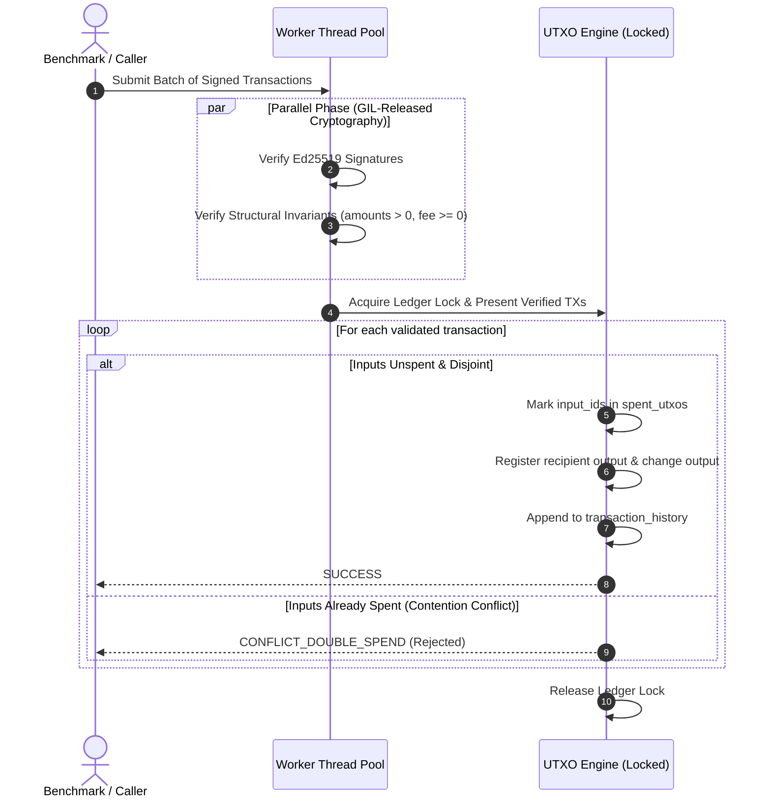
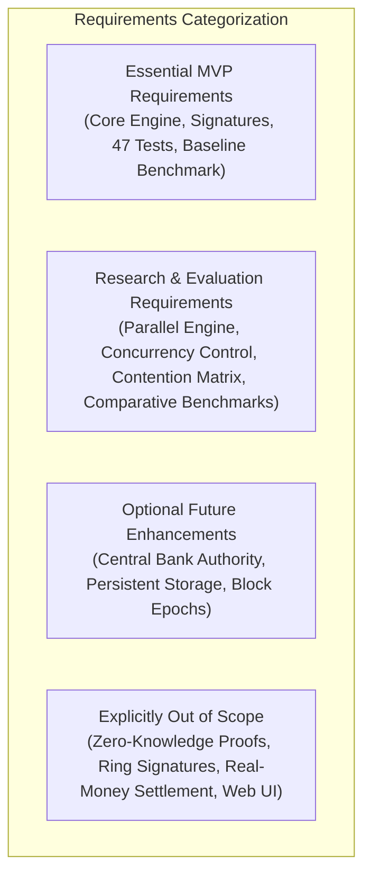

# Product Requirements Document (PRD): CBDC Privacy System

**Document Version:** 1.0.0
**Status:** Approved
**Author:** Senior Software Engineer, Product Architect & Research Project Advisor
**Project Path:** `C:\Users\sumit\cbdc-privacy-system`
**Reference Baseline:** `docs/stage0-scope.md`

---

## 1. Project Overview and Purpose

The **CBDC Privacy System** is an educational and research-oriented digital currency simulator engineered to investigate transaction validation architectures in an Unspent Transaction Output (UTXO) ledger model. The system simulates core digital currency operations—including Ed25519 asymmetric cryptographic wallets, UTXO state tracking, balance calculation, transaction fee deduction, automated change outputs, transaction history immutability, and double-spending rejection.

The simulator provides a deterministic, rigorous testbed to evaluate whether **safe parallel transaction validation** can improve transaction throughput compared with sequential validation while preserving UTXO integrity and preventing race conditions or double-spending anomalies.

> [!NOTE]
> This system is strictly an academic and educational simulation operating in memory using synthetic test currency. It is not a production CBDC, real-money settlement system, or commercial banking rail.

---

## 2. Problem Statement and Motivation

Digital currency payment architectures, including Central Bank Digital Currencies (CBDCs), require high transaction throughput, low latency, and uncompromising transaction validity:

1. **Sequential Validation Bottleneck:** Standard sequential transaction validation processes transactions one at a time. While sequentially ordered processing is inherently immune to concurrency race conditions, throughput is hard-capped by single-threaded CPU speed, clock frequency, and CPU-intensive asymmetric signature verification overhead.
2. **Double-Spending Hazards under Concurrency:** Validating transactions concurrently across multiple threads or processor cores introduces critical race conditions (Time-of-Check to Time-of-Use / TOCTOU). Two concurrent transactions may attempt to spend the exact same unspent output simultaneously. Without synchronization, concurrent validation risks double spending, unspent output desynchronization, and balance corruption.
3. **Evaluation Rigor:** Concurrency speedup claims in blockchain and distributed ledger literature often ignore synchronization overhead, lock contention, thread context switching, latency tail distributions (p95/p99), and memory pressure. A controlled, reproducible empirical evaluation is required.

---

## 3. Research Question, Hypothesis, and Measurable Research Objectives

### 3.1 Core Research Question
> *"Can safe parallel transaction validation improve throughput compared with sequential validation while preserving UTXO integrity?"*

### 3.2 Improvement Hypothesis
Safe parallel validation can improve throughput over sequential validation for workloads with **non-conflicting transactions** (transactions spending disjoint UTXO sets), primarily because asymmetric signature verification (Ed25519) can be executed concurrently across worker threads releasing the Python Global Interpreter Lock (GIL) via native cryptographic C-libraries.

However, under workloads with high UTXO contention (multiple transactions competing for identical inputs), synchronization overhead, lock contention, and conflict aborts may degrade throughput relative to sequential execution.

### 3.3 Measurable Research Objectives
1. **Zero Integrity Violations (Absolute Requirement):** Maintain 100% UTXO consistency across all workloads. Zero double-spends, zero ledger corruptions, and zero balance discrepancies across 100% of sequential and parallel runs.
2. **Empirical Baseline Characterization:** Quantify sequential baseline performance across three standard workload sizes: **100**, **1,000**, and **10,000** transactions. Measure wall-clock execution time, throughput (tx/s), latency distributions (mean, p50, p95, p99), CPU utilization %, and peak memory footprint.
3. **Speedup Quantification:** Measure the parallel-to-sequential speedup ratio ($S = \text{Throughput}_{\text{parallel}} / \text{Throughput}_{\text{sequential}}$) under multi-threaded execution.
4. **Contention Sensitivity Profiling:** Benchmark both execution engines under three controlled contention regimes:
   - **0% Contention:** 100% disjoint UTXO inputs (embarrassingly parallelizable).
   - **20% Contention:** Moderate input collision (20% of transactions contend for shared UTXOs).
   - **50% Contention:** High input collision / hotspot scenario.

---

## 4. Target Users and Use Cases

### 4.1 Target Users
* **Digital Currency Researchers:** Investigating UTXO validation pipelining, concurrency control, and throughput trade-offs.
* **Systems & Blockchain Engineers:** Studying transaction verification lifecycles, race hazards, and state machine replication principles in Python.
* **Academic Reviewers & Evaluators:** Validating reproducible benchmarks and empirical experimental results.

### 4.2 Core Use Cases
* **UC-01 (Simulator Test-Fund Issuance):** Simulator generates initial unspent outputs assigned to a target wallet address (`issue_test_funds`).
* **UC-02 (Signed Peer-to-Peer Payment):** Sender wallet signs a payment payload with Ed25519; engine validates signature, verifies UTXO ownership and spendable status, deducts fee, assigns recipient output, and creates sender change output.
* **UC-03 (Sequential Baseline Benchmarking):** Benchmark runner feeds batches of 100, 1,000, and 10,000 transactions into the sequential engine, logging throughput, latency, CPU, and memory metrics.
* **UC-04 (Safe Parallel Batch Validation):** System distributes signature and structural verification across a worker thread pool, followed by an atomic synchronization phase committing valid state transitions and rejecting conflicting spends.
* **UC-05 (Adversarial Double-Spend Defense):** System detects concurrent transactions attempting to spend identical UTXOs; exactly one succeeds and all others are safely rejected without ledger corruption.

---

## 5. Existing Implementation and Current Limitations

### 5.1 Verified Current State (as of October 11, 2026)
* **UTXO Engine (`src/utxo_engine.py`):**
  - In-memory UTXO mapping (`self.utxos: dict[str, UTXO]`) and spent tracking (`self.spent_utxos: set[str]`).
  - Simulator-only issuance (`issue_test_funds`) generating unique IDs (`genesis-{owner}-{id}`).
  - Synchronous `transfer` executing state mutation with fee accounting and change calculation.
  - Ed25519-signed payments (`transfer_signed`) matching registered wallet addresses.
  - Collision-resistant output ID generation (`tx-{id}-out-1`, `tx-{id}-out-2`).
  - Deep-copied immutable history queries (`get_transaction_history`).
  - Read-only validation split (`_prepare_transfer`, `validate_transfer`) verifying payments without ledger modification.
* **Wallet Subsystem (`src/wallet.py`):**
  - Ed25519 keypair generation via `cryptography.hazmat.primitives.asymmetric.ed25519`.
  - Raw public key hex address format (64-character hex strings).
  - Deterministic canonical JSON message serialization with sorted dictionary keys and sorted input IDs.
* **Automated Test Suite (`tests/`):**
  - **47 passing tests** in `pytest` (41 in `tests/test_utxo_engine.py`, 6 in `tests/test_wallet.py`). Zero failures.
* **Baseline Benchmark (`benchmarks/baseline.py`):**
  - 1,000 sequential transactions executed in ~0.0102 seconds (~98,300 tx/s) for pure in-memory transfers.

### 5.2 Current Limitations
1. **Single-Threaded Architecture:** `UTXOEngine` contains no mutexes or synchronization primitives. Concurrent calls to `transfer()` induce race conditions on `self.spent_utxos`, `self.utxos`, `self.next_transaction_id`, and `self.transaction_history`.
2. **No Parallel Execution Pipeline:** No thread pool, batch validator, or concurrency manager currently exists.
3. **Benchmark Scope Limitations:** Current benchmark does not measure latency percentiles (p50/p95/p99), CPU utilization, memory allocations, signature verification costs, or contention scenarios.
4. **Unstructured Transaction Payloads:** Transfers are executed via individual method arguments rather than a unified `Transaction` data structure.

---

## 6. Functional Requirements

### 6.1 UTXO Ledger and State Model
* **FR-UTXO-01 (UTXO Record):** The system shall model unspent outputs as immutable records containing `output_id: str`, `owner: str`, and `amount: int` ($> 0$).
* **FR-UTXO-02 (Spent Output Tracking):** The system shall track consumed outputs in `spent_utxos: set[str]`, permanently preventing any output from being spent multiple times.
* **FR-UTXO-03 (Balance Invariant):** The system shall calculate wallet balance as the exact sum of all unspent outputs assigned to that wallet owner.
* **FR-UTXO-04 (Collision Resistance):** The system shall reject any operation that produces a duplicate `output_id` before modifying ledger state.
* **FR-UTXO-05 (History Immutability):** The system shall record all successful transactions in `transaction_history` and return deep copies to prevent external mutation.
* **FR-UTXO-06 (Test-Fund Issuance):** The system shall support simulator-only test-fund issuance (`issue_test_funds`), assigning funds with unique genesis IDs and strict positive integer validation.

### 6.2 Wallet and Asymmetric Cryptography
* **FR-WAL-01 (Keypair Generation):** Wallets shall generate cryptographically secure Ed25519 keypairs upon instantiation.
* **FR-WAL-02 (Address Derivation):** Wallet addresses shall be derived deterministically as the raw 32-byte public key encoded in hexadecimal (64 hex characters).
* **FR-WAL-03 (Registration Integrity):** The engine shall register wallets, rejecting duplicate owner identifiers and preventing one wallet key from being assigned to multiple owners.
* **FR-WAL-04 (Canonical Payment Serialization):** Wallets shall serialize payment payloads into canonical JSON with sorted keys, compact separators (`:`, `,`), and sorted input IDs prior to signing.
* **FR-WAL-05 (Signature Verification):** The engine shall verify Ed25519 signatures against registered wallet public keys before executing any signed payment, rejecting tampered amounts, recipients, fees, or input IDs.

### 6.3 Transaction Validation and Execution
* **FR-VAL-01 (Read-Only Validation):** The system shall provide a non-mutating validation routine (`validate_transfer`) that performs all checks without altering ledger state.
* **FR-VAL-02 (Parameter Validation):** The system shall enforce: sender $\neq$ recipient, amount $> 0$ (int), fee $\ge 0$ (int), and non-empty `input_ids`.
* **FR-VAL-03 (Duplicate Input Rejection):** The system shall reject transactions containing duplicate input IDs within their own input list.
* **FR-VAL-04 (UTXO Existence & Spend Status):** The system shall verify that each input ID exists in `utxos` and is absent from `spent_utxos`.
* **FR-VAL-05 (Ownership Verification):** The system shall verify that each referenced UTXO is strictly owned by the declared sender.
* **FR-VAL-06 (Conservation of Value):** The system shall enforce $\sum \text{Inputs} \ge \text{Amount} + \text{Fee}$ and calculate $\text{Change} = \sum \text{Inputs} - (\text{Amount} + \text{Fee})$.
* **FR-VAL-07 (All-or-Nothing Atomicity):** If validation fails for any reason, zero ledger mutations, fee accumulations, or history records shall occur.

### 6.4 Concurrency and Safe Parallel Validation
* **FR-CONC-01 (Thread-Safe Ledger):** The engine shall maintain thread safety across concurrent operations using fine-grained synchronization locks.
* **FR-CONC-02 (Two-Stage Parallel Pipeline):** The parallel engine shall execute in two explicit stages:
  1. **Stage 1 (Parallel Validation):** Dispatches signature verification and read-only structural checks across worker threads (`ThreadPoolExecutor`), releasing the Python GIL during cryptographic C operations.
  2. **Stage 2 (Atomic Commit & Conflict Resolution):** Synchronously commits valid transactions to the ledger and detects conflicts.
* **FR-CONC-03 (Deterministic Conflict Resolution):** When multiple concurrent transactions contend for the same UTXO, the first transaction to reach commit succeeds; subsequent conflicting transactions are rejected with a structured status (`CONFLICT_DOUBLE_SPEND`).
* **FR-CONC-04 (Equivalence Invariant):** The final ledger state resulting from parallel validation of non-conflicting transactions must be identical to that of sequential validation.

### 6.5 Performance Evaluation and Benchmarking
* **FR-BENCH-01 (Standard Workloads):** The benchmark suite shall evaluate transaction batches of **100**, **1,000**, and **10,000** transactions.
* **FR-BENCH-02 (Contention Matrix):** The benchmark suite shall test three controlled contention profiles:
  - **0% Contention:** 100% independent senders and disjoint UTXOs.
  - **20% Contention:** 20% of transactions share input UTXOs.
  - **50% Contention:** 50% of transactions contend for hotspot UTXOs.
* **FR-BENCH-03 (Comparative Harness):** The benchmark suite shall run sequential and parallel engines under identical hardware, operating system, and initial ledger states.
* **FR-BENCH-04 (Comprehensive Metrics):** The benchmark suite shall measure:
  - Throughput (transactions per second).
  - Total elapsed wall-clock time (seconds).
  - Per-transaction latency percentiles (mean, p50, p95, p99 in milliseconds).
  - CPU utilization percentage during run.
  - Peak memory consumption (RSS / tracemalloc bytes).
  - Success count, failure count, and conflict abort count.
* **FR-BENCH-05 (Statistical Rigor):** Benchmarks shall include 1 warm-up run followed by 3 measured runs, reporting mean and standard deviation. Test setup (genesis issuance) shall be excluded from timing.

---

## 7. Non-Functional Requirements (NFRs)

* **NFR-INTEG-01 (Zero Ledger Corruption):** Under concurrent execution of up to 10,000 transactions, the system shall maintain zero double-spends, zero orphaned spent records, and zero balance inconsistencies.
* **NFR-TEST-01 (Regression Prevention):** All 47 existing unit tests must remain passing at 100% at all times. New concurrency and benchmark code must include automated unit and integration tests.
* **NFR-ENV-01 (Environment Compatibility):** System must execute reliably on standard Python 3.13 on Windows 10/11 x64 using only standard library modules and the existing `cryptography` dependency.
* **NFR-PERF-01 (Measurement Isolation):** Benchmark timers must isolate the transaction processing window from test-fund pre-allocation, wallet key generation, and post-benchmark reporting.

---

## 8. Transaction Correctness and UTXO Integrity Requirements

### 8.1 Mathematical Invariants
1. **Transaction Balance Conservation:**
   $$\sum_{u \in \text{Inputs}(T)} \text{Amount}(u) = \text{Amount}(T) + \text{Fee}(T) + \text{Change}(T)$$
2. **System Currency Conservation:**
   $$\sum_{u \in \text{Genesis}} \text{Amount}(u) = \sum_{u \in \text{Unspent}} \text{Amount}(u) + \sum_{T \in \text{History}} \text{Fee}(T)$$
3. **Double-Spend Invariance:**
   $$\forall u \in \text{UTXO}, \quad u \in \text{spent\_utxos} \iff \exists! T \in \text{History} \text{ such that } u \in \text{Inputs}(T)$$
4. **Output Identifier Uniqueness:**
   $$\forall u_1, u_2 \in \text{UTXO}, \quad u_1 \neq u_2 \iff \text{output\_id}(u_1) \neq \text{output\_id}(u_2)$$

---

## 9. Concurrency, Conflict Handling, and Threat Analysis

### 9.1 Two-Phase Validation & Commit Architecture

### 9.2 Threat Model and Security Mitigations
| Threat ID | Threat Vector | Impact | System Defense Mechanism |
| :--- | :--- | :--- | :--- |
| **THREAT-01** | **Sequential Double Spend** | Duplicate asset consumption | Permanent tracking in `spent_utxos`; rejected in `_prepare_transfer`. |
| **THREAT-02** | **Concurrent Double Spend (Race)** | Inconsistent ledger balances | Synchronized atomic commit phase; first-to-commit wins, competing spends rejected. |
| **THREAT-03** | **Signature Tampering** | Unauthorized fund redirection | Ed25519 cryptographic verification over canonical JSON; tampered payload rejected. |
| **THREAT-04** | **Foreign Input Spending** | Theft of other users' UTXOs | Strict ownership assertion (`utxo.owner == sender`) enforced prior to commit. |
| **THREAT-05** | **Negative Value Injection** | Inflation / arbitrary fund creation | Strict type checking (`type(x) is int`) and range checks (`amount > 0`, `fee >= 0`). |
| **THREAT-06** | **Output ID Collision** | Ledger output overwrite | Output collision check against existing UTXOs prior to committing state changes. |

---

## 10. Data Models and Transaction Lifecycle

### 10.1 Core Data Models
* **`UTXO` (dataclass, frozen):**
  - `output_id: str`
  - `owner: str`
  - `amount: int`
* **`Transaction` (dataclass):**
  - `sender: str`
  - `recipient: str`
  - `amount: int`
  - `fee: int`
  - `input_ids: list[str]`
  - `signature: bytes | None`
* **`TransactionResult` (dict / dataclass):**
  - `transaction_id: int`
  - `status: str` (`"SUCCESS"`, `"REJECTED"`, `"CONFLICT_DOUBLE_SPEND"`)
  - `sender: str`
  - `recipient: str`
  - `amount: int`
  - `fee: int`
  - `input_ids: list[str]`
  - `change: int`
  - `outputs: list[UTXO]`

---

## 11. Requirement Categorization

### 11.1 Essential MVP Requirements
- In-memory UTXO transaction engine (`src/utxo_engine.py`).
- Ed25519 wallet registration and signature verification (`src/wallet.py`).
- Decoupled read-only validation (`validate_transfer`).
- 47 passing unit and regression tests in pytest.
- Baseline sequential benchmark (`benchmarks/baseline.py`).

### 11.2 Research & Evaluation Requirements
- Parallel validation pipeline (`ThreadPoolExecutor`) with cryptographic GIL release.
- Thread-safe state synchronization and double-spend conflict detection.
- Comparative benchmark suite measuring sequential vs. parallel performance.
- Workload tiers: 100, 1,000, and 10,000 transactions.
- Contention matrix profiling: 0%, 20%, and 50% contention.
- Multi-metric reporting: throughput (tx/s), latency (mean, p50, p95, p99), CPU %, RSS memory, and conflict rates.

### 11.3 Optional Future Enhancements
- Role-based Central Bank Authority for issuance (`AuthorityWallet`).
- Block-based transaction grouping and epoch-based state commitments.
- Persistent storage backends (SQLite or LMDB).
- Multi-signature threshold spending (M-of-N).

### 11.4 Explicitly Out-of-Scope Features
- **Cryptographic Privacy Protocols:** Zero-Knowledge Proofs (zk-SNARKs/zk-STARKs), Bulletproofs, Ring Signatures, Confidential Transactions, Stealth Addresses (deferred per core project constraint).
- **Production Banking Integrations:** Real-Time Gross Settlement (RTGS), ISO 20022 messaging, KYC/AML regulatory reporting.
- **Distributed Consensus Algorithms:** Proof of Work (PoW), Proof of Stake (PoS), Raft, PBFT (single-node validator simulator).
- **Web UI & Dashboards:** System is designed strictly for programmatic research and CLI evaluation.

---

## 12. Error Handling and System Invariants

1. **Deterministic Errors:** All validation failures must raise explicit exceptions in sequential mode (`ValueError`) or return explicit structured error statuses in batch/parallel mode (`{"status": "REJECTED", "reason": ...}`).
2. **Failure Insulation:** A failed transaction must never:
   - Alter any wallet balance.
   - Mark any UTXO as spent in `spent_utxos`.
   - Add partial outputs to `utxos`.
   - Increment `total_fees` or `next_transaction_id`.
   - Record an entry into `transaction_history`.
3. **Atomic Rollback on Error:** Any runtime error during validation or commit immediately aborts the transaction with zero side-effects.

---

## 13. Testing and Acceptance Criteria

### 13.1 Acceptance Criteria
* **AC-01:** Existing 47 unit tests pass with zero errors or modifications.
* **AC-02:** Concurrency test suite executes $\ge 1,000$ concurrent transactions and proves 0 double spends and 0 corrupted balances.
* **AC-03:** Benchmark harness executes sequential and parallel workloads across 100, 1,000, and 10,000 transactions.
* **AC-04:** Contention matrix benchmark successfully executes across 0%, 20%, and 50% collision rates, capturing throughput, latency percentiles (p50/p95/p99), CPU %, and memory usage.
* **AC-05:** Research evaluation objectively analyzes the hypothesis without pre-assuming throughput gains.

---

## 14. Risks, Assumptions, and Dependencies

* **Risk 1 (Python GIL Overhead):** Pure Python dictionary manipulations are single-threaded due to the GIL.
  * *Mitigation:* Decouple CPU-bound Ed25519 signature checks (which execute in C via `cryptography` and release the GIL) from state commit.
* **Risk 2 (Lock Contention under High Collision):** Heavy contention on shared inputs may cause parallel performance to fall below sequential performance.
  * *Mitigation:* Document this finding honestly as an empirical answer to the research question.
* **Dependencies:** Python 3.13 standard library (`concurrent.futures`, `dataclasses`, `time`, `tracemalloc`, `psutil` or standard metrics), and `cryptography` ($\ge 42.0.0$).

---

## 15. Success Metrics and Evidence Required to Claim Success

To claim success for the project, the repository must furnish the following verified artifacts:
1. **Pass Rate Evidence:** 100% passing tests on `pytest` across both existing unit tests and new concurrency stress tests.
2. **Empirical Benchmark Logs:** Documented performance tables comparing Sequential vs. Parallel across:
   - 100, 1,000, and 10,000 transactions.
   - 0%, 20%, and 50% contention.
   - Reporting: throughput (tx/s), speedup factor ($S$), p50/p95/p99 latency, CPU %, and memory footprint.
3. **Hypothesis Evaluation Report:** A clear, evidence-based conclusion addressing the core research question: whether safe parallel validation improves throughput, under what contention conditions, and what trade-offs were observed.
