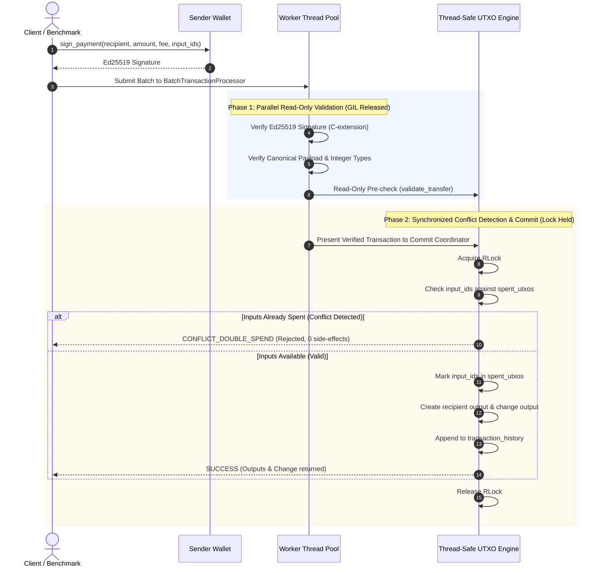

# System Architecture Document: CBDC Privacy System

**Document Version:** 1.0.0
**Status:** Approved
**Author:** Senior Software Architect and Technical Designer
**Project Path:** `C:\Users\sumit\cbdc-privacy-system`
**Reference Documents:** `PRD.md`, `docs/stage0-scope.md`

---

## 1. System Overview and Architectural Principles

The **CBDC Privacy System** is an educational and research-oriented digital currency simulator built to investigate transaction validation throughput and integrity under an Unspent Transaction Output (UTXO) ledger model.

### 1.1 Architectural Principles
1. **Uncompromising Ledger Integrity:** Total currency supply and individual wallet balances must remain invariant under all execution conditions. Zero double-spending, zero lost funds, and zero state corruption are tolerated.
2. **Two-Phase Validation and Commit Separation:** Decouple computationally intensive, read-only transaction verification (cryptographic Ed25519 signature checks and structural validation) from state-mutating ledger commits.
3. **Deterministic Concurrency Control:** Concurrency must never introduce non-deterministic state corruption or race conditions. Conflicting transactions competing for identical UTXOs must resolve deterministically (first-to-commit wins; subsequent competing spends are rejected with zero side-effects).
4. **Empirical Evaluation Without Preconceptions:** Avoid claiming parallel speedups prior to measurement. Accurately capture and measure the real-world trade-offs of multi-threading, lock contention, Python Global Interpreter Lock (GIL) release behavior, and conflict aborts against a sequential baseline.
5. **Educational Scope and Backward Compatibility:** Maintain clean, dependency-light Python code. All existing public APIs, data models, and automated tests (47/47 passing) remain 100% operational without regression.

---

## 2. Existing Architecture vs. Proposed Architecture

### 2.1 Existing Architecture
* **Monolithic Synchronous Engine:** `UTXOEngine` combines in-memory ledger state (`self.utxos`, `self.spent_utxos`), signature verification, business rule validation, fee accounting, and history tracking in a single synchronous thread.
* **Immediate In-Place Mutation:** `transfer()` and `transfer_signed()` validate inputs and mutate state sequentially in one pass. Helper methods (`_prepare_transfer()` and `validate_transfer()`) provide read-only validation but have no thread synchronization.
* **Concurrency Vulnerability:** Any concurrent access across threads causes race conditions (TOCTOU) on `self.spent_utxos`, `self.utxos`, `self.next_transaction_id`, and `self.transaction_history`.
* **Single-Threaded Baseline Benchmark:** `benchmarks/baseline.py` measures only sequential transfers with aggregate elapsed timing, omitting latency percentiles, memory, CPU, and contention.

### 2.2 Proposed Architecture
* **Thread-Safe Core Engine:** Preserve `UTXOEngine` with all existing public methods, protected by a re-entrant mutual exclusion lock (`threading.RLock`) guarding ledger mutations.
* **Two-Phase Parallel Validation Pipeline:**
  - **Phase 1 (Parallel Read-Only Validation):** A worker pool (`concurrent.futures.ThreadPoolExecutor`) verifies Ed25519 digital signatures and validates transaction parameters concurrently across multiple CPU cores.
  - **Phase 2 (Synchronized Conflict Detection & Atomic Commit):** A synchronized commit coordinator processes verified transactions, verifies input availability against `spent_utxos` inside the critical section, marks inputs as spent, generates new outputs, updates fees, and records transaction history atomically.
* **Structured Batch Processing:** Introduce a `BatchTransactionProcessor` that orchestrates batch submission, parallel worker dispatch, conflict resolution, and structured reporting (`SUCCESS`, `REJECTED`, `CONFLICT_DOUBLE_SPEND`).
* **Comprehensive Benchmark Suite:** An extended evaluation harness measuring throughput (tx/s), latency distributions (mean, p50, p95, p99), CPU utilization %, peak memory allocations (`tracemalloc`), across 100, 1,000, and 10,000 transactions and 0%, 20%, and 50% contention tiers.

```mermaid
graph TD
    subgraph Existing Architecture
        A1[Caller / Script] -->|Synchronous Call| B1[UTXOEngine]
        B1 -->|Immediate State Mutation| C1[(In-Memory UTXOs & Spent Set)]
    end

    subgraph Proposed Architecture
        A2[Caller / Benchmark Harness] -->|Submit Batch| B2[BatchTransactionProcessor]
        B2 -->|Phase 1: Worker Threads| C2[Worker Thread Pool]
        C2 -->|Verify Ed25519 & Rules<br/>Releases GIL in C| C2
        C2 -->|Validated Payloads| D2[Atomic Commit Coordinator]
        D2 -->|Phase 2: Acquire RLock| E2[Thread-Safe UTXOEngine]
        E2 -->|Detect Conflicts & Commit| F2[(In-Memory UTXOs & Spent Set)]
        D2 -->|Release RLock| E2
        D2 -->|Return Results & Metrics| A2
    end
```



---

## 3. Component Responsibilities and Boundaries

| Component | Module Path | Primary Responsibility | Architectural Boundary |
| :--- | :--- | :--- | :--- |
| **`UTXO`** | `src/utxo_engine.py` | Immutable data representation of an unspent output (`output_id`, `owner`, `amount`). | Read-only value object. |
| **`Transaction`** | `src/utxo_engine.py` | Standardized transaction record (`tx_id`, `sender`, `recipient`, `amount`, `fee`, `input_ids`, `signature`). | Payload data transfer object. |
| **`Wallet`** | `src/wallet.py` | Ed25519 keypair generation, public key hex address derivation, canonical JSON payment signing, and signature verification. | Cryptographic boundary; zero state interaction. |
| **`UTXOEngine`** | `src/utxo_engine.py` | In-memory ledger state (`utxos`, `spent_utxos`), wallet registry, genesis issuance, atomic single-transaction execution, and state queries. | Core authoritative state machine. Protected by re-entrant mutex. |
| **`BatchTransactionProcessor`** | `src/batch_processor.py` | Orchestrates two-phase parallel validation, manages worker thread pool, dispatches validation tasks, and streams results to atomic commit. | Concurrency and orchestration boundary. |
| **`BenchmarkRunner`** | `benchmarks/compare_parallel.py` | Generates synthetic workloads (100, 1K, 10K) across contention tiers (0%, 20%, 50%), isolates setup from measurement, captures multi-metric data. | Evaluation and reporting boundary. |

---

## 4. UTXO Ledger, Wallet, Signing, and Validation Responsibilities

### 4.1 Wallet & Signing Subsystem
* Generates asymmetric keypair using `cryptography.hazmat.primitives.asymmetric.ed25519`.
* Produces canonical payment strings via `Wallet.create_payment_message(sender, recipient, amount, fee, input_ids)`:
  - Sorted dictionary keys (`sort_keys=True`).
  - Compact delimiters (`separators=(',', ':')`).
  - Sorted input IDs (`input_ids=sorted(input_ids)`).
* Signs UTF-8 encoded canonical message bytes; exports 64-character public key hex address (`get_address()`).

### 4.2 UTXO Ledger Subsystem
* Maintains immutable set of consumed outputs: `self.spent_utxos = set()`.
* Maintains map of all outputs: `self.utxos = dict()`.
* Tracks total collected fees and monotonic transaction counter.
* Guarantees that query methods (`get_balance()`, `get_unspent_outputs()`, `get_transaction_history()`) return unspent values or deep copies to prevent external corruption.

### 4.3 Validation Subsystem
* **Stateless Structural Validation:** Verifies argument types (integers), positivity ($> 0$), non-negative fees ($\ge 0$), distinct sender/recipient, and absence of duplicate inputs within the transaction.
* **Cryptographic Verification:** Verifies Ed25519 signature against registered wallet public key.
* **Stateful Input Validation:** Verifies that all `input_ids` exist in the ledger, have not been recorded in `spent_utxos`, belong to `sender`, and satisfy $\sum \text{Inputs} \ge \text{Amount} + \text{Fee}$.

---

## 5. Transaction Lifecycle



---

## 6. Sequential vs. Safe Parallel Validation Workflows

### 6.1 Sequential Workflow
1. Client calls `transfer_signed()` in a loop.
2. For each transaction:
   - Verifies signature (synchronously on main thread).
   - Verifies inputs, balances, and non-spent status.
   - Mutates ledger state immediately.
3. Characteristics: Simple, zero concurrency hazards, but signature verification bottlenecks the main thread.

### 6.2 Safe Parallel Workflow
1. Client passes a batch of $N$ signed transactions to `BatchTransactionProcessor.process_batch(transactions)`.
2. **Parallel Stage (Workers):**
   - Batches of transactions are distributed across worker threads via `ThreadPoolExecutor`.
   - Each worker verifies the Ed25519 signature and executes `validate_transfer()` against the current ledger snapshot.
   - Invalid signatures or structurally malformed transactions are flagged as `REJECTED` immediately.
3. **Commit Stage (Coordinator):**
   - Transactions passing Phase 1 are submitted to the atomic commit coordinator.
   - The coordinator acquires `self._lock` and inspects each transaction's `input_ids`.
   - **Conflict Detection:** If any input ID has already been marked in `spent_utxos` by an earlier transaction in the same batch or a prior commit, the transaction is rejected with status `CONFLICT_DOUBLE_SPEND`.
   - If all inputs are unspent, the coordinator marks them spent, inserts output UTXOs, updates fees, increments transaction ID, and logs history.
   - Lock is released.

---

## 7. Concurrency Model, Python GIL, and Shared-State Protection

### 7.1 Python Global Interpreter Lock (GIL) Analysis
* In pure Python, multi-threading cannot execute Python bytecode simultaneously across multiple CPU cores because of the GIL.
* **Core Insight:** Asymmetric Ed25519 signature verification in the `cryptography` library is executed in compiled C code (OpenSSL / PyCA cryptography), which **releases the GIL** during cryptographic verification (`Py_BEGIN_ALLOW_THREADS`).
* Therefore:
  - A multi-threaded architecture will achieve measurable speedup for signed transaction batches, because the CPU-heavy signature checks execute concurrently across hardware cores.
  - For unsigned in-memory transfers, multi-threading would introduce thread context-switching and lock overhead without GIL release benefits. The benchmark suite tests both to measure the exact boundary.

### 7.2 Double-Spend Prevention Guarantee
To guarantee that two concurrent transactions spending the same UTXO can never both commit:
1. `UTXOEngine` maintains a single re-entrant lock: `self._lock = threading.RLock()`.
2. The commit sequence within `_commit_transfer()` is atomic:
   ```python
   with self._lock:
       # Re-verify inputs inside the critical section
       for output_id in input_ids:
           if output_id in self.spent_utxos:
               return {"status": "CONFLICT_DOUBLE_SPEND", "reason": f"UTXO {output_id} already spent"}
       # Atomic state mutation
       for output_id in input_ids:
           self.spent_utxos.add(output_id)
       for out in new_outputs:
           self.utxos[out.output_id] = out
       self.total_fees += fee
       self.next_transaction_id += 1
       self.transaction_history.append(record)
   ```
3. Because the check-and-set sequence occurs entirely inside the critical section, Time-of-Check to Time-of-Use (TOCTOU) race conditions are mathematically impossible.

---

## 8. External Dependencies and Justifications

| Dependency | Version in `.venv` | Purpose & Architectural Justification |
| :--- | :--- | :--- |
| **`cryptography`** | `50.0.2` | High-performance, constant-time Ed25519 asymmetric cryptography. Essential for digital signatures, addressing, and GIL-released multi-core parallel verification. |
| **`pytest`** | `9.1.1` | Automated test runner. Executes unit, regression, and concurrency test suites. |
| **Python Standard Library** | Built-in (3.13) | `concurrent.futures` (thread pool execution), `threading` (synchronization locks), `tracemalloc` (peak memory tracking), `time` (nanosecond `perf_counter` and `process_time`), `dataclasses`, `json`. |

> [!NOTE]
> No additional heavy frameworks (such as Celery, Redis, FastAPI, or SQLAlchemy) are introduced. The architecture remains lightweight, portable, and self-contained within Python standard library + `cryptography`.

---

## 9. Logging, Reproducibility, and Benchmark-Result Storage

1. **Deterministic Benchmark Seeding:** Synthetic workloads generate deterministic sender/recipient keys and deterministic issuance sequences to ensure 100% reproducible benchmark runs.
2. **Measurement Isolation:** Workload generation (genesis issuance and key generation) is strictly isolated from timed transaction loops.
3. **Structured Result Storage:** Benchmark results will be output in both formatted terminal Markdown tables and persisted to structured JSON files in `benchmarks/results/` (e.g., `benchmark_results_<timestamp>.json`) containing:
   - System environment metadata (CPU model, core count, OS, Python version).
   - Workload parameters (count, contention rate, worker count, signed vs unsigned).
   - Performance metrics (elapsed time, throughput, latency p50/p95/p99, CPU %, peak memory).

---

## 10. Testing Strategy

1. **Unit & Invariant Tests (Existing):** Preserve 100% pass rate for all 47 existing tests in `tests/test_utxo_engine.py` and `tests/test_wallet.py`.
2. **Concurrency Stress Tests (`tests/test_concurrency.py`):**
   - **Non-Conflicting Concurrent Test:** 1,000 threads simultaneously submitting independent transactions; assert 1,000 successes, 0 failures, 100% balance conservation.
   - **Double-Spend Race Test:** Multiple threads simultaneously submitting transactions spending the exact same UTXO; assert exactly 1 succeeds, all others receive `CONFLICT_DOUBLE_SPEND`, spent set has length 1, zero balance corruption.
   - **Interleaved Read/Write Test:** Queries to `get_balance()` and `get_transaction_history()` executing concurrently with batch transfers without deadlocks or inconsistent snapshots.
3. **Regression Tests:** Ensure legacy sequential calls to `transfer()` and `transfer_signed()` behave identically to previous commits.

---

## 11. Security, Threat Model, and Limitations

### 11.1 Threat Mitigation Summary
* **Double Spending:** Prevented via atomic check-and-add to `spent_utxos` inside `self._lock`.
* **Transaction Forgery / Modification:** Prevented via Ed25519 signature checks over canonical JSON payloads with sorted keys and sorted inputs.
* **Unauthorized Issuance:** `issue_test_funds()` is explicitly isolated as a simulator genesis tool; production minting authority is out of scope for this simulator.
* **Input Collision / Replay Attacks:** Deduplicated input validation (`len(input_ids) == len(set(input_ids))`) and unique output ID format (`tx-{id}-out-{idx}`).

### 11.2 Architectural Limitations
* **Single-Node In-Memory Storage:** Ledger state is stored in RAM. It does not survive process termination.
* **No Byzantine Consensus:** The simulator assumes a trusted centralized validator node; distributed consensus protocols (PoW/PoS/BFT) are deliberately out of scope.
* **No Cryptographic Privacy (ZKPs):** Addresses are pseudonymous public key hex strings; amounts and inputs are unblinded in transaction records per project constraints.

---

## 12. Scalability Constraints and Bottlenecks

1. **Python GIL for Pure Bytecode:** Pure Python dict lookups and state management cannot scale across cores. Scalability is achieved by offloading Ed25519 cryptographic verification to C worker threads.
2. **Memory Footprint:** In-memory `utxos` and `spent_utxos` grow linearly with transaction count ($O(N)$). For 10,000 transactions, RAM footprint remains under 50 MB, which is well within desktop capabilities.
3. **Lock Contention under High Collision:** Under 50% contention, threads frequently queue for the commit lock, and conflict rejection rates increase. This is an expected empirical characteristic to be measured and documented.

---

## 13. Architectural Decisions, Trade-Offs, and Alternatives

| Architectural Decision | Chosen Option | Alternative Considered | Trade-Off Rationale |
| :--- | :--- | :--- | :--- |
| **Concurrency Model** | **Thread-based (`ThreadPoolExecutor`)** | Process-based (`multiprocessing.Pool`) | Threads share in-memory ledger state with zero IPC serialization overhead. Cryptographic verification in `cryptography` releases GIL in C, giving multi-core performance without multiprocessing pickling bottlenecks. |
| **Validation Scope** | **Parallelize Signature & Structural Checks** | Parallelize state mutation | Parallelizing state mutation causes write-write conflicts on shared dicts. Parallelizing verification while serializing/locking commit preserves 100% integrity with zero race hazards. |
| **Conflict Resolution** | **First-to-Commit Wins; Conflicting Spends Rejected** | Optimistic lock with automatic retry | Immediate rejection mirrors real-world UTXO validators (e.g. Bitcoin/Cardano). Automatic retries mask double-spend attempts and distort benchmark timings. |
| **User Interface** | **CLI & Benchmark Scripts** | Web Dashboard / REST API | Aligned with PRD.md constraints. Prevents scope bloat and focuses 100% on research evaluation. |
