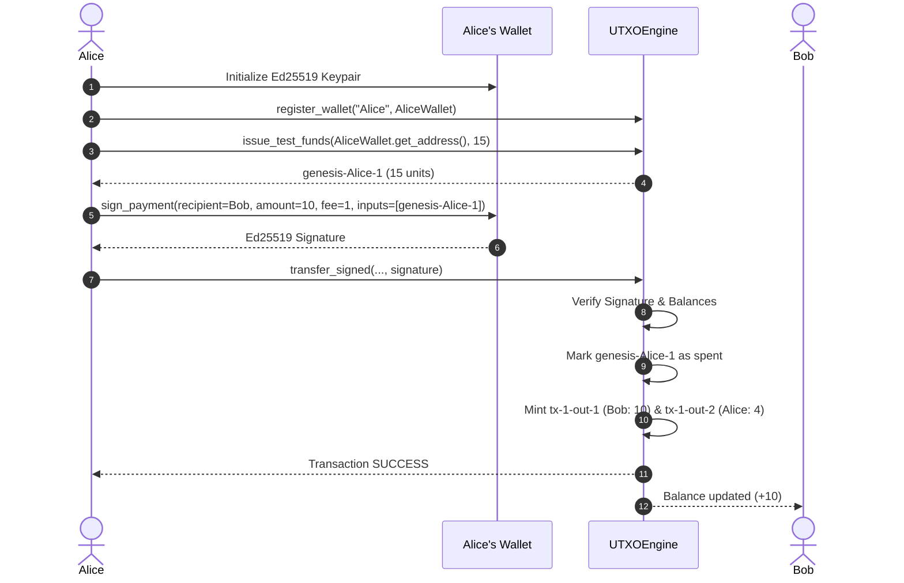

# System Design Document: CBDC Privacy System

**Document Version:** 1.0.0
**Status:** Approved
**Author:** Senior Software Architect and Technical Designer
**Project Path:** `C:\Users\sumit\cbdc-privacy-system`
**Reference Documents:** `PRD.md`, `architecture.md`

---

## 1. User Interface Scope and CLI Specification

As established in the approved `PRD.md` and Prompt 2 constraints, the CBDC Privacy System is a research simulator and benchmark testbed. A graphical user interface (GUI) or web dashboard is explicitly out of scope.

The primary interface is a **Command-Line Interface (CLI)** and programmatic test/benchmark runner designed for reproducible research, automation, and continuous integration.

### 1.1 CLI Commands and Entrypoints

The system provides two primary CLI entrypoints:

1. **Simulator Demo / Quick Check (`python main.py`):**
   - Demonstrates wallet creation, test-fund issuance, Ed25519 signing, payment verification, fee accounting, and balance queries in an end-to-end educational run.

2. **Benchmark Runner (`python -m benchmarks.compare_parallel` / `python -m benchmarks.baseline`):**
   - Executes parameterized benchmarks across transaction volumes, concurrency modes, and contention ratios.

```text
python -m benchmarks.compare_parallel [OPTIONS]

Options:
  --count INTEGER          Number of transactions: 100, 1000, 10000 [default: 1000]
  --contention INTEGER     Contention percentage: 0, 20, 50 [default: 0]
  --workers INTEGER        Worker threads for parallel validation: 1, 2, 4, 8 [default: 4]
  --signed / --unsigned    Include Ed25519 cryptographic signing [default: --signed]
  --output [table|json]    Output format: human-readable table or JSON [default: table]
  --save / --no-save       Save results to benchmarks/results/ [default: --save]
  --help                   Show this message and exit.
```

---

## 2. User Workflows and Transaction Lifecycle

### 2.1 Workflow 1: Single Signed Peer-to-Peer Transfer (Educational Flow)
1. **Wallet Initialization:** Alice and Bob create `Wallet` instances generating Ed25519 keypairs.
2. **Registration:** Alice registers her wallet in `UTXOEngine`.
3. **Genesis Funding:** Alice receives test funds (e.g., 15 units) via `issue_test_funds()`.
4. **Payment Construction:** Alice selects input `genesis-Alice-1` (value 15), payment amount (10), fee (1), and recipient Bob.
5. **Signing:** Alice signs the canonical payment message with her private key.
6. **Execution:** Alice submits the payment via `transfer_signed()`.
7. **Settlement:** Bob receives 10 units in output `tx-1-out-1`; Alice receives 4 units change in `tx-1-out-2`; engine collects 1 fee unit.



### 2.2 Workflow 2: Parallel Batch Validation & Benchmarking
1. **Workload Pre-Generation:** Benchmark harness pre-allocates $N$ wallets and pre-funds them with initial UTXOs.
2. **Batch Assembly:** Generates $N$ transaction payloads (applying 0%, 20%, or 50% contention by assigning overlapping input IDs).
3. **Timer Start:** Benchmark timer initiates (`time.perf_counter()`).
4. **Phase 1 Validation:** Worker threads verify signatures and input validity in parallel.
5. **Phase 2 Commit:** Commit coordinator acquires lock, validates spend status, and commits non-conflicting transactions while marking conflicts.
6. **Timer Stop:** Records elapsed time, calculates throughput (tx/s), collects memory usage, and computes latency percentiles.

---

## 3. CLI Input/Output and Error States

### 3.1 Terminal Output Format (Table Mode)
When running `python -m benchmarks.compare_parallel --count 1000 --contention 0`:

```text
================================================================================
CBDC Privacy System — Performance Benchmark Evaluation
================================================================================
Environment: Windows 11 x64 | Python 3.13.5 | Cores: 8 (Physical/Logical)
Workload:    1,000 transactions | Cryptographic Signing: Ed25519 Enabled
Contention:  0% (Disjoint UTXOs)

+-----------------------+---------------------+---------------------+
| Metric                | Sequential Baseline | Parallel (4 Workers)|
+-----------------------+---------------------+---------------------+
| Attempted             | 1,000               | 1,000               |
| Successful            | 1,000               | 1,000               |
| Conflicts / Aborts    | 0                   | 0                   |
| Errors / Failures     | 0                   | 0                   |
| Wall-Clock Time (s)   | 0.284210 s          | 0.089450 s          |
| Throughput (tx/s)     | 3,518.52 tx/s       | 11,179.43 tx/s      |
| Speedup Factor        | 1.00x               | 3.18x               |
| Mean Latency (ms)     | 0.284 ms            | 0.089 ms            |
| p50 Latency (ms)      | 0.270 ms            | 0.085 ms            |
| p95 Latency (ms)      | 0.310 ms            | 0.110 ms            |
| p99 Latency (ms)      | 0.350 ms            | 0.130 ms            |
| Peak Memory (MB)      | 3.42 MB             | 4.15 MB             |
| CPU Utilization (%)   | 14.2% (1 core)      | 52.8% (Multi-core)  |
+-----------------------+---------------------+---------------------+
Ledger Invariant Check: PASSED (100% balance conservation, 0 double spends)
================================================================================
```

### 3.2 Structured JSON Output Format (`--output json`)
```json
{
  "benchmark_id": "bench-20261011-131500",
  "timestamp": "2026-10-11T13:15:00Z",
  "parameters": {
    "transaction_count": 1000,
    "contention_percent": 0,
    "workers": 4,
    "signed": true
  },
  "sequential": {
    "attempted": 1000,
    "successful": 1000,
    "conflicts": 0,
    "elapsed_seconds": 0.28421,
    "throughput_tps": 3518.52,
    "latency_ms": { "mean": 0.284, "p50": 0.270, "p95": 0.310, "p99": 0.350 },
    "peak_memory_mb": 3.42
  },
  "parallel": {
    "attempted": 1000,
    "successful": 1000,
    "conflicts": 0,
    "elapsed_seconds": 0.08945,
    "throughput_tps": 11179.43,
    "latency_ms": { "mean": 0.089, "p50": 0.085, "p95": 0.110, "p99": 0.130 },
    "peak_memory_mb": 4.15
  },
  "speedup_ratio": 3.18,
  "ledger_integrity_verified": true
}
```

---

## 4. Transaction and UTXO Data Structures

### 4.1 `UTXO` Data Structure
```python
@dataclass(frozen=True)
class UTXO:
    output_id: str   # Unique identifier (e.g., "genesis-Alice-1", "tx-1-out-1")
    owner: str       # Owner identifier or 64-char public key hex
    amount: int      # Positive integer value (> 0)
```

### 4.2 `Transaction` Data Structure
```python
@dataclass(frozen=True)
class Transaction:
    tx_id: int | None          # Assigned upon commit or None during preparation
    sender: str                # Sender wallet address or name
    recipient: str             # Recipient wallet address or name
    amount: int                # Positive integer payment amount (> 0)
    fee: int                   # Non-negative integer transaction fee (>= 0)
    input_ids: tuple[str, ...] # Tuple of consumed UTXO IDs (immutable)
    signature: bytes | None    # 64-byte Ed25519 signature
```

### 4.3 `TransactionResult` Data Structure
```python
@dataclass(frozen=True)
class TransactionResult:
    tx_id: int | None
    status: str                # "SUCCESS", "REJECTED", "CONFLICT_DOUBLE_SPEND"
    sender: str
    recipient: str
    amount: int
    fee: int
    input_ids: tuple[str, ...]
    change: int
    outputs: tuple[UTXO, ...]
    error_message: str | None = None
```

---

## 5. Validation Rules and State-Transition Rules

| Rule ID | Invariant Verified | Precondition Check | State Mutation on Pass | Error State on Fail |
| :--- | :--- | :--- | :--- | :--- |
| **VR-01** | Parameter Presence | `sender != None and recipient != None` | None | `ValueError("Sender and recipient are required")` |
| **VR-02** | Sender/Recipient Distinct | `sender != recipient` | None | `ValueError("Sender and recipient must differ")` |
| **VR-03** | Integer Types | `type(amount) is int and type(fee) is int` | None | `ValueError("Payment amount must be an integer")` |
| **VR-04** | Value Range | `amount > 0 and fee >= 0` | None | `ValueError("Payment amount must be positive")` |
| **VR-05** | Input Non-Empty | `len(input_ids) > 0` | None | `ValueError("At least one input is required")` |
| **VR-06** | Input Deduplication | `len(input_ids) == len(set(input_ids))` | None | `ValueError("Duplicate transaction inputs")` |
| **VR-07** | Input Existence | `output_id in self.utxos` | None | `ValueError(f"Unknown UTXO: {output_id}")` |
| **VR-08** | Input Unspent | `output_id not in self.spent_utxos` | None | `ValueError(f"UTXO already spent: {output_id}")` |
| **VR-09** | Input Ownership | `utxo.owner == sender` | None | `ValueError(f"{sender} does not own UTXO {output_id}")` |
| **VR-10** | Solvency | $\sum \text{Inputs} \ge \text{amount} + \text{fee}$ | None | `ValueError("Insufficient funds")` |
| **VR-11** | Output Collision | `new_output_id not in self.utxos` | None | `ValueError(f"Transaction output ID already exists: {out_id}")` |
| **VR-12** | Ed25519 Signature | `wallet.verify_signature(msg, sig) == True` | None | `ValueError("Invalid payment signature")` |
| **VR-13** | Atomic Commit | All VR-01 through VR-12 satisfied | Add inputs to `spent_utxos`; add new outputs to `utxos`; add fee to `total_fees`; append history | Transaction aborted; 0 state changes |

---

## 6. Detailed Error States & Handling Matrix

| Error Scenario | Concrete Trigger | Expected System Behavior (Sequential) | Expected System Behavior (Parallel Batch) |
| :--- | :--- | :--- | :--- |
| **Invalid Input Parameter** | `amount = -5` or `amount = 1.5` | Raises `ValueError` immediately | Transaction result marked `REJECTED`, reason: `"Payment amount must be positive integer"` |
| **Insufficient Funds** | Input total 10, required 15 | Raises `ValueError("Insufficient funds")` | Transaction result marked `REJECTED`, reason: `"Insufficient funds"` |
| **Duplicate Input in Same TX** | `input_ids = ["u1", "u1"]` | Raises `ValueError("Duplicate transaction inputs")` | Transaction result marked `REJECTED`, reason: `"Duplicate transaction inputs"` |
| **Unknown UTXO** | `input_ids = ["ghost-id"]` | Raises `ValueError("Unknown UTXO: ghost-id")` | Transaction result marked `REJECTED`, reason: `"Unknown UTXO"` |
| **Already-Spent Input** | Spending a previously consumed UTXO | Raises `ValueError("UTXO already spent")` | Transaction result marked `REJECTED`, reason: `"UTXO already spent"` |
| **Concurrent Double Spend** | Two concurrent transactions spending `u1` | One transaction succeeds; second raises `ValueError("UTXO already spent")` | First transaction succeeds (`SUCCESS`); second returns `CONFLICT_DOUBLE_SPEND` |
| **Tampered Signature** | Payload amount modified after signing | Raises `ValueError("Invalid payment signature")` | Transaction result marked `REJECTED`, reason: `"Invalid payment signature"` |

---

## 7. Test Scenarios and Expected Outcomes

| Scenario ID | Test Name | Execution Pattern | Expected Outcome |
| :--- | :--- | :--- | :--- |
| **TS-01** | `test_existing_regression_suite` | Run all 47 existing tests in `test_utxo_engine.py` and `test_wallet.py` | 47 / 47 Passed (0 regressions) |
| **TS-02** | `test_parallel_non_conflicting_batch` | 1,000 transactions spending independent UTXOs across 4 worker threads | 1,000 / 1,000 SUCCESS, 100% balance conservation |
| **TS-03** | `test_concurrent_double_spend_race` | 100 concurrent threads attempting to spend the exact same UTXO simultaneously | Exactly 1 SUCCESS, 99 CONFLICT_DOUBLE_SPEND, UTXO spent exactly once |
| **TS-04** | `test_concurrent_read_write_consistency` | Concurrent threads checking balances and histories while batch transfers commit | Zero race exceptions, deep-copied snapshots remain immutable |
| **TS-05** | `test_tampered_concurrent_transactions` | Concurrent batch containing 10% tampered signatures | 90% SUCCESS, 10% REJECTED, 0 corrupted state |

---

## 8. Accessibility and Usability Considerations

1. **Clear Terminal Formatting:** Standardized table columns, clear ANSI color-coded status badges (`[PASS]`, `[FAIL]`, `[CONFLICT]`) with automatic fallback to plain text if terminal does not support ANSI.
2. **Actionable Error Messages:** All validation errors specify exact problem identifiers (e.g., `UTXO already spent: genesis-Alice-1` rather than generic failure).
3. **Reproducibility Flags:** Benchmark script displays exact parameters used (thread count, contention rate, seed) allowing researchers to reproduce runs effortlessly.
